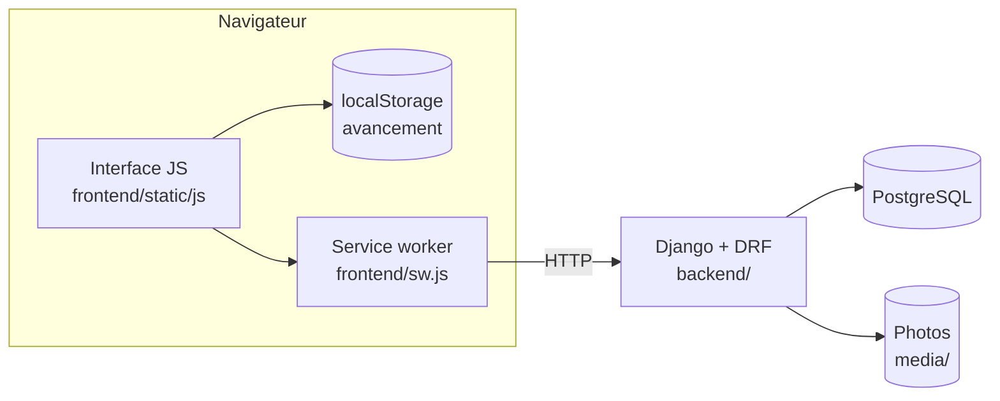
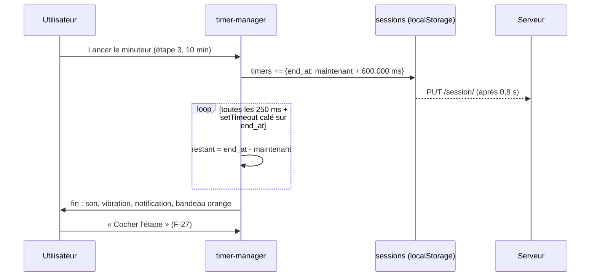

# Architecture

## Vue d'ensemble

Un seul serveur Django sert à la fois l'API (`/api/…`) et l'interface (`/`,
`/static/…`). L'authentification se fait par **session Django** (cookie) avec
protection CSRF : pas de jeton à gérer côté navigateur, et l'interface est sur
la même origine que l'API.

## Pourquoi ces choix

- **Django + DRF** : modèle de données relationnel simple (recette →
  ingrédients / étapes), administration intégrée, comptes et hachage des mots
  de passe fournis (NF-08).
- **JavaScript sans framework** : pas d'étape de build, chargement rapide
  (NF-03), modules ES natifs servis tels quels. Le code reste petit et lisible.
- **PostgreSQL** : proposé par le cahier des charges ; SQLite suffit en
  développement grâce à `DATABASE_URL`.

## Backend (`backend/`)

| App | Rôle | Fichiers clés |
| --- | --- | --- |
| `config` | Réglages, URL, vues qui servent `index.html`, `sw.js`, le manifeste | `settings.py`, `urls.py`, `views.py` |
| `accounts` | Utilisateur identifié par e-mail ; inscription, connexion, export et suppression (NF-09) | `models.py`, `views.py` |
| `recipes` | Recette, Ingrédient, Étape ; CRUD, recherche, filtres, photo | `models.py`, `serializers.py`, `views.py` |
| `cooking` | Session de cuisine : étapes et ingrédients cochés, minuteurs | `models.py`, `serializers.py`, `views.py` |

Points importants :

- **Isolation des données** (NF-08) : chaque requête filtre sur
  `owner=request.user` ; une recette d'un autre utilisateur renvoie 404.
- **Écriture des ingrédients et étapes en bloc** : on envoie la liste
  complète, l'ordre de la liste devient le champ `order`. C'est ce qui rend le
  réordonnancement (F-04) trivial. Une liste absente du PATCH n'est pas modifiée.
- **Session de cuisine séparée de la recette** (§5 du cahier des charges) :
  une par couple (utilisateur, recette). Les minuteurs y sont stockés en JSON
  avec leur **heure de fin** (`end_at`, ms), jamais un compte à rebours.

## Frontend (`frontend/`)

Modules dans `static/js/` :

| Module | Rôle | Testé sous Node |
| --- | --- | --- |
| `app.js` | Point d'entrée : authentification, routage par ancre `#/…` | |
| `api.js` | Appels à l'API, CSRF, erreurs (`ApiError`, `OfflineError`) | |
| `timers.js` | **Logique pure** des minuteurs : création, pause, reprise, ±1 min, format | ✅ `tests/timers.test.mjs` |
| `cooking-state.js` | **Logique pure** du mode cuisine : étape en cours, progression, fusion local/serveur, portions | ✅ `tests/cooking-state.test.mjs` |
| `sessions.js` | Sauvegarde de l'avancement : localStorage immédiat + envoi différé au serveur | |
| `timer-manager.js` | Bandeau global des minuteurs, détection de fin, alertes répétées | |
| `alerts.js` | Son (Web Audio), vibration, notification | |
| `storage.js` | Accès protégé à localStorage | |
| `dom.js` | `h()` pour créer des éléments (sans `innerHTML`, donc sans XSS), messages | |
| `views/*.js` | Un écran par fichier : `auth`, `list`, `detail`, `edit`, `cook`, `account` | |

Règle de conception : **toute logique non triviale va dans un module pur**
(`timers.js`, `cooking-state.js`) et est testée ; les vues ne font que de
l'affichage et des appels.

### Routage

| Ancre | Écran |
| --- | --- |
| `#/connexion`, `#/inscription` | `views/auth.js` |
| `#/recettes` | `views/list.js` |
| `#/recettes/nouvelle`, `#/recettes/:id/modifier` | `views/edit.js` |
| `#/recettes/:id` | `views/detail.js` |
| `#/recettes/:id/cuisine` | `views/cook.js` |
| `#/compte` | `views/account.js` |

Une vue est une fonction `(root, params)` ; si elle renvoie une fonction,
celle-ci est appelée en quittant l'écran (nettoyage : abonnements, verrou
d'écran…).

### Minuteurs : comment ils restent justes

Comme on recalcule toujours `end_at - maintenant`, un onglet en arrière-plan,
une mise en veille ou un rechargement ne faussent pas le temps (F-25, NF-04).
Le drapeau `alerted` évite de redéclencher l'alerte après un rechargement.

### Hors ligne (NF-05)

- `sw.js` met en cache l'application au premier chargement, puis chaque
  réponse `GET /api/…` (réseau d'abord, cache en secours).
- L'avancement est écrit d'abord dans localStorage ; s'il n'a pas pu partir,
  il est renvoyé à l'évènement `online`. À l'ouverture, `pickNewest()` garde la
  copie la plus récente entre locale et serveur.
- À la déconnexion, le cache de l'API et les sessions locales sont vidés.

**Attention** : après toute modification d'un fichier de `frontend/`,
incrémenter `VERSION` dans `frontend/sw.js` pour que les navigateurs prennent
la nouvelle version (voir [developpement.md](developpement.md)).
