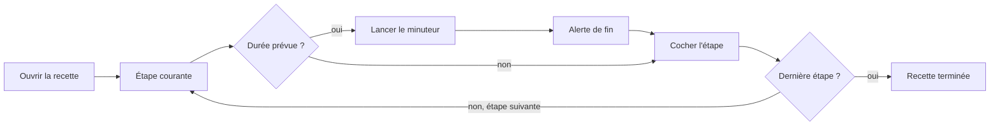

# Cahier des charges – Application web de recettes

> Copie versionnée du cahier des charges rédigé sur claude.ai le 23/11/2026
> (doc source : https://claude.ai/artifact/F17DaxvD3L1uC1K3uqHzAJ).
> En cas de modification du besoin, mettre à jour **ce fichier** dans le même
> commit que le code concerné, puis le suivi dans [suivi-exigences.md](suivi-exigences.md).

## 1. Présentation du projet

L'objectif est de livrer une application web qui permet d'enregistrer ses recettes et de les suivre en cuisinant : chaque étape se coche une fois terminée, et un minuteur se lance en un clic avec la durée prévue par l'étape.

**Contexte.** Les recettes papier ou les sites classiques obligent à relire la page pour savoir où l'on en est, et à régler un minuteur à part sur son téléphone. L'application réunit ces deux gestes au même endroit.

**Objectifs**

- Centraliser ses recettes personnelles dans un seul outil, accessible depuis un navigateur.
- Suivre l'avancement d'une recette en cours sans perdre le fil.
- Lancer les minuteurs nécessaires directement depuis l'étape concernée.

**Périmètre de la première version**

- Inclus : création, modification, consultation et suppression de recettes ; mode cuisine avec étapes à cocher ; minuteurs par étape.
- Exclu (à étudier plus tard) : partage social, application mobile native, planification de menus, liste de courses.

## 2. Utilisateurs cibles et cas d'usage

La première version vise un cuisinier amateur qui gère ses propres recettes, sur ordinateur pour la saisie et sur téléphone ou tablette posé en cuisine.

| Cas d'usage | Description | Appareil principal |
| --- | --- | --- |
| Enregistrer une recette | Saisir titre, ingrédients, étapes et durées | Ordinateur |
| Retrouver une recette | Chercher par nom, ingrédient ou catégorie | Tous |
| Cuisiner une recette | Suivre les étapes une par une et les cocher | Téléphone, tablette |
| Minuter une cuisson | Lancer le minuteur prévu par l'étape, être alerté à la fin | Téléphone, tablette |
| Modifier une recette | Ajuster quantités, étapes ou temps après l'avoir testée | Tous |

## 3. Exigences fonctionnelles

Trois modules couvrent le besoin : la gestion des recettes, le mode cuisine avec étapes à cocher, et les minuteurs. Chaque exigence porte un identifiant pour être suivie pendant le développement.

### 3.1 Gestion des recettes

| ID | Exigence | Priorité |
| --- | --- | --- |
| F-01 | Créer une recette : titre, description, photo (facultative), nombre de portions, temps de préparation et de cuisson, catégorie | Indispensable |
| F-02 | Ajouter une liste d'ingrédients : quantité, unité, nom | Indispensable |
| F-03 | Ajouter des étapes ordonnées, chacune avec un texte et une durée facultative (en minutes et secondes) | Indispensable |
| F-04 | Réordonner, modifier ou supprimer une étape | Indispensable |
| F-05 | Modifier et supprimer une recette (avec confirmation avant suppression) | Indispensable |
| F-06 | Lister toutes les recettes et rechercher par titre ou ingrédient | Indispensable |
| F-07 | Filtrer par catégorie (entrée, plat, dessert…) ou par étiquette | Souhaitable |
| F-08 | Ajuster le nombre de portions et recalculer les quantités | Souhaitable |
| F-09 | Marquer des recettes en favoris | Souhaitable |

### 3.2 Mode cuisine et étapes à cocher

| ID | Exigence | Priorité |
| --- | --- | --- |
| F-10 | Ouvrir une recette en « mode cuisine » : affichage épuré, gros caractères ; les ingrédients restent en haut de l'écran et l'étape en cours s'affiche juste en dessous | Indispensable |
| F-11 | Cocher une étape terminée la fait disparaître de la liste ; l'étape suivante remonte et devient l'étape en cours, juste sous les ingrédients, sans avoir à faire défiler | Indispensable |
| F-12 | Annuler une étape cochée par erreur (bouton « Annuler » affiché quelques secondes) ; les étapes terminées sont rangées dans une petite barre repliable « Étapes terminées (n) », fermée par défaut, qui s'ouvre d'un appui pour les relire ou en décocher une | Indispensable |
| F-13 | Cocher les ingrédients au fur et à mesure de leur préparation | Souhaitable |
| F-14 | Afficher la progression (ex. : « 3 étapes sur 7 ») | Souhaitable |
| F-15 | Conserver l'avancement si la page est rechargée ou l'appareil mis en veille | Indispensable |
| F-16 | Réinitialiser l'avancement pour recommencer la recette | Indispensable |
| F-17 | Empêcher la mise en veille de l'écran pendant le mode cuisine | Souhaitable |

### 3.3 Minuteurs

| ID | Exigence | Priorité |
| --- | --- | --- |
| F-20 | Chaque étape qui a une durée affiche un bouton « Lancer le minuteur » préréglé sur cette durée | Indispensable |
| F-21 | Mettre en pause, reprendre, réinitialiser ou arrêter un minuteur | Indispensable |
| F-22 | Alerter à la fin : signal sonore, vibration sur mobile si disponible, notification du navigateur si l'onglet n'est pas au premier plan | Indispensable |
| F-23 | Faire tourner plusieurs minuteurs en même temps (ex. : cuisson des pâtes et de la sauce), chacun nommé d'après son étape | Indispensable |
| F-24 | Garder les minuteurs visibles en permanence dans un bandeau, même en faisant défiler la recette | Indispensable |
| F-25 | Rester justes si l'onglet passe en arrière-plan (calcul à partir de l'heure de fin, pas d'un simple compte à rebours) | Indispensable |
| F-26 | Ajouter ou retirer une minute à un minuteur en cours | Souhaitable |
| F-27 | Proposer de cocher l'étape quand son minuteur se termine | Souhaitable |
| F-28 | Lancer un minuteur libre, sans lien avec une étape | Optionnel |

## 4. Parcours utilisateur en mode cuisine

L'utilisateur avance étape par étape ; une étape avec une durée propose son minuteur, et cocher la dernière étape termine la recette. Les minuteurs continuent de tourner pendant qu'on passe aux étapes suivantes (F-23).

## 5. Modèle de données

Une recette contient des ingrédients et des étapes ; l'avancement en cuisine est stocké à part, pour ne pas modifier la recette elle-même quand on la cuisine.

| Entité | Champs principaux | Relations |
| --- | --- | --- |
| Utilisateur | id, e-mail, nom, mot de passe chiffré, date de création | Possède des recettes |
| Recette | id, titre, description, photo, portions, temps de préparation (min), temps de cuisson (min), catégorie, étiquettes, favori, dates de création et de modification | Appartient à un utilisateur ; contient des ingrédients et des étapes |
| Ingrédient | id, recette, ordre, quantité, unité, nom | Appartient à une recette |
| Étape | id, recette, ordre, texte, durée du minuteur (secondes, facultative), libellé du minuteur | Appartient à une recette |
| Session de cuisine | id, recette, utilisateur, date de début, étapes cochées, ingrédients cochés, minuteurs actifs (étape, heure de fin, en pause ou non, temps restant si en pause) | Liée à une recette |

Stocker l'heure de fin d'un minuteur, plutôt que le temps restant, permet de le retrouver juste après un rechargement de page (F-15, F-25).

## 6. Exigences non fonctionnelles

L'application doit d'abord être utilisable les mains occupées, sur un téléphone posé sur le plan de travail.

| ID | Domaine | Exigence |
| --- | --- | --- |
| NF-01 | Responsive | Interface adaptée aux écrans de 360 px (téléphone) à 1920 px (ordinateur) |
| NF-02 | Ergonomie en cuisine | Zones tactiles d'au moins 48 × 48 px ; texte des étapes d'au moins 18 px en mode cuisine |
| NF-03 | Performance | Ouverture d'une recette en moins de 2 secondes sur une connexion 4G |
| NF-04 | Précision des minuteurs | Écart inférieur à 1 seconde par rapport à la durée réglée, y compris onglet en arrière-plan |
| NF-05 | Hors ligne | Une recette déjà ouverte reste consultable et cuisinable sans connexion (application web progressive) |
| NF-06 | Navigateurs | Deux dernières versions de Chrome, Safari (iOS et macOS), Firefox et Edge |
| NF-07 | Accessibilité | Respect du niveau AA des recommandations WCAG 2.1 (contrastes, navigation au clavier, lecteurs d'écran) |
| NF-08 | Sécurité | Connexion en HTTPS, mots de passe chiffrés, chaque utilisateur n'accède qu'à ses recettes |
| NF-09 | Données personnelles | Conformité au RGPD : export et suppression du compte et des données à la demande |
| NF-10 | Sauvegarde | Sauvegarde quotidienne de la base de données, conservée 30 jours |
| NF-11 | Langue | Interface en français |

## 7. Contraintes techniques et architecture proposée

Aucune technologie n'est imposée à ce stade ; la pile ci-dessous est une proposition courante, que le prestataire ou l'équipe peut remplacer en justifiant son choix.

| Couche | Proposition | Rôle |
| --- | --- | --- |
| Interface | React, Vue ou Svelte, en application web progressive (PWA) | Écrans, mode cuisine, minuteurs côté navigateur |
| Serveur (API) | Node.js, Python ou PHP, API REST | Comptes, enregistrement et lecture des recettes |
| Base de données | PostgreSQL ou équivalent | Recettes, ingrédients, étapes, sessions |
| Stockage des photos | Stockage objet (type S3) | Images des recettes, redimensionnées |
| Hébergement | Hébergeur en Europe | Conformité RGPD |

> **Choix retenu pour ce dépôt** : Django + Django REST Framework, PostgreSQL,
> interface en HTML/CSS/JavaScript sans framework, en PWA. Justification dans
> [architecture.md](architecture.md).

**Fonctions du navigateur à utiliser**

- **Notifications** : prévenir de la fin d'un minuteur quand l'onglet n'est pas visible (avec l'accord de l'utilisateur).
- **Wake Lock** : garder l'écran allumé en mode cuisine (F-17).
- **Service Worker** : fonctionnement hors ligne et installation sur l'écran d'accueil (NF-05).
- **Vibration et audio** : alerte de fin de minuteur.

**Point d'attention.** Sur iPhone, Safari limite les notifications et les sons quand l'application est en arrière-plan, surtout si elle n'est pas installée sur l'écran d'accueil. Une phase de test sur appareils réels est à prévoir pour valider F-22.

## 8. Priorisation : MVP et évolutions

La première version livrable (MVP) regroupe toutes les exigences « Indispensable » ; le reste arrive par lots, dans l'ordre ci-dessous.

| Lot | Contenu | Exigences |
| --- | --- | --- |
| V1 – MVP | Comptes, création et recherche de recettes, mode cuisine, étapes à cocher, minuteurs multiples avec alertes | F-01 à F-06, F-10 à F-12, F-15, F-16, F-20 à F-25, NF-01 à NF-11 |
| V1.1 – Confort | Catégories et étiquettes, portions ajustables, favoris, ingrédients à cocher, progression, écran toujours allumé, minuteur +1 min | F-07 à F-09, F-13, F-14, F-17, F-26, F-27 |
| V2 – Pistes | Minuteur libre, import d'une recette depuis une URL, liste de courses, partage d'une recette, lecture vocale des étapes | F-28 et nouvelles exigences à rédiger |

## 9. Planning indicatif et livrables

Le MVP peut être livré en 10 à 12 semaines environ pour une petite équipe (1 à 2 développeurs) ; ces durées sont à confirmer selon les ressources réelles.

1. **Cadrage et maquettes** (2 semaines) : validation de ce cahier des charges, maquettes des écrans principaux (liste, fiche recette, édition, mode cuisine).
2. **Socle technique** (1 semaine) : hébergement, base de données, comptes utilisateurs.
3. **Gestion des recettes** (3 semaines) : F-01 à F-06.
4. **Mode cuisine et minuteurs** (3 semaines) : F-10 à F-12, F-15, F-16, F-20 à F-25.
5. **Tests et recette** (2 semaines) : tests sur téléphones réels (iPhone et Android), corrections, accessibilité.
6. **Mise en ligne** (1 semaine) : déploiement, suivi des premiers usages.

**Livrables attendus**

- Maquettes des écrans
- Code source versionné (dépôt Git) et documentation d'installation
- Application déployée et accessible en ligne
- Cahier de tests avec les résultats
- Guide d'utilisation court

## 10. Hypothèses et questions ouvertes

Ces points ont été supposés pour rédiger le document ; chacun est à confirmer ou corriger avant le lancement.

- [ ] **Utilisateurs** : l'application est-elle personnelle (vous seul), familiale, ou ouverte à tous avec création de compte ?
- [ ] **Comptes** : faut-il une connexion, ou les recettes peuvent-elles rester stockées dans le navigateur sans compte ?
- [ ] **Réalisation** : développement par vous-même, une équipe interne ou un prestataire externe ?
- [ ] **Budget et date** : quel budget et quelle date de mise en ligne visée ?
- [x] **Technologies** : Django + DRF, PostgreSQL, JavaScript sans framework (décidé le 23/11/2026).
- [ ] **Recettes existantes** : faut-il importer des recettes déjà saisies ailleurs (fichier, site, carnet) ?
- [ ] **Monétisation** : projet personnel, ou modèle payant à terme ?
